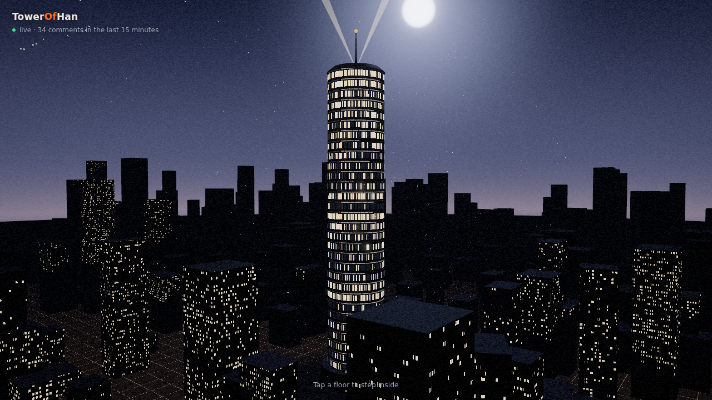
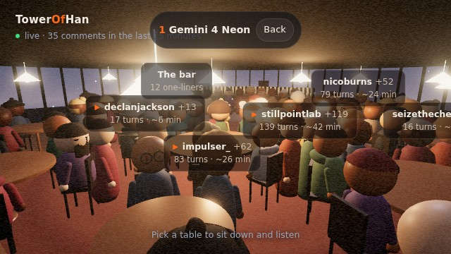

# TowerOfHan.io

Hacker News as a living tower. Every floor is a front-page story, every table is a thread, and the people at it speak their comments, verbatim, in their own voices, as the conversation happens.

## See it

[`docs/img/first-cut.mp4`](docs/img/first-cut.mp4) is 51 s with sound: tonight's front page, a ride up to floor #1, and a table talking in its own voices. It was rendered headlessly on a software GPU, so it looks softer and slower than on a real one.

| The live tower | Floors trade ranks |
|---|---|
|  |  |
| **A floor** | **At a table** |
|  |  |

## Run it locally

You need:
- Node 24+
- Python 3.10–3.13, with `pip install -r apps/voice-worker/requirements.txt`
- a WebGPU browser (Chrome, Edge, or Safari 26+)

```sh
scripts/dev.sh                 # live HN + voice worker + the client
open http://127.0.0.1:5288
```

**Voices.** The default is Kokoro on one CPU thread. It's free, and every HN user gets a unique, permanent blend of two built-in voices.
- Kokoro runs a little slower than real time. So the best tables on the top floors are pre-voiced in the background, and any table you sit at jumps the queue.
- For character-actor delivery: `TTS_ENGINE=openai OPENAI_API_KEY=sk-... scripts/dev.sh`. That uses gpt-4o-mini-tts, with a persistent persona per person plus the comment's emotion. Spend is capped by `OPENAI_BUDGET_MIN` (default 300 minutes ≈ $4.50).
- Per-comment emotion and stance tags come from `GEMINI_API_KEY=...`. Without it, a heuristic is used.

## Using it

- **Tower.** Drag to orbit, and hover a floor to see its story. Click to ride the elevator up.
  - Floors slide when stories trade ranks.
  - Windows flash when a comment lands.
  - The beacon pulses for every new comment on the front page.
- **Floor.** Pick a table (▶ means it's voiced), or the bar, where the one-off remarks are.
- **Table.** Space pauses, N moves to the next table, Esc stands you up, M mutes.
  - Links are held up as placards you can click.
  - When someone quotes the comment they're answering, its author speaks the quote.
- **Lean back:** top right on the tower. It rides to the liveliest floor, plays its best tables one after another, then moves down the ranking, hands-free.
- **Deep link:** `?story=<id>&table=<root comment id>` (the address bar updates as you sit down).

## Layout

```
packages/core       speakability, play order, seats, permanent voices, live state (13 tests: `node --test packages/core/src/*.test.ts`)
apps/towerd         local stand-in for the edge + CDN: follows live HN, writes head/epoch/floor files, queues voicing
apps/voice-worker   tags, voices (Kokoro or OpenAI), writes clips + sidecars with loudness and mouth-shape tracks
apps/client         the 3D client: three.js on WebGPU, plain TypeScript
spikes/ research/   the first night's experiments and evidence
docs/PLAN.md        the plan; docs/img has the demos
```

## Status

This is the first cut and runs locally only. Deployment follows `docs/PLAN.md` (Cloudflare R2 + CDN, one GPU box).
