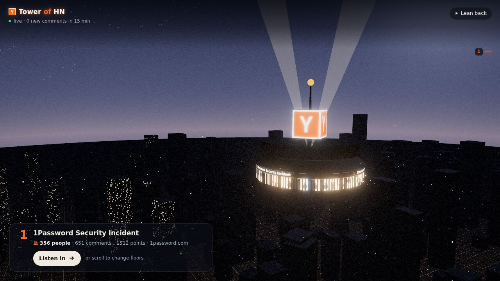
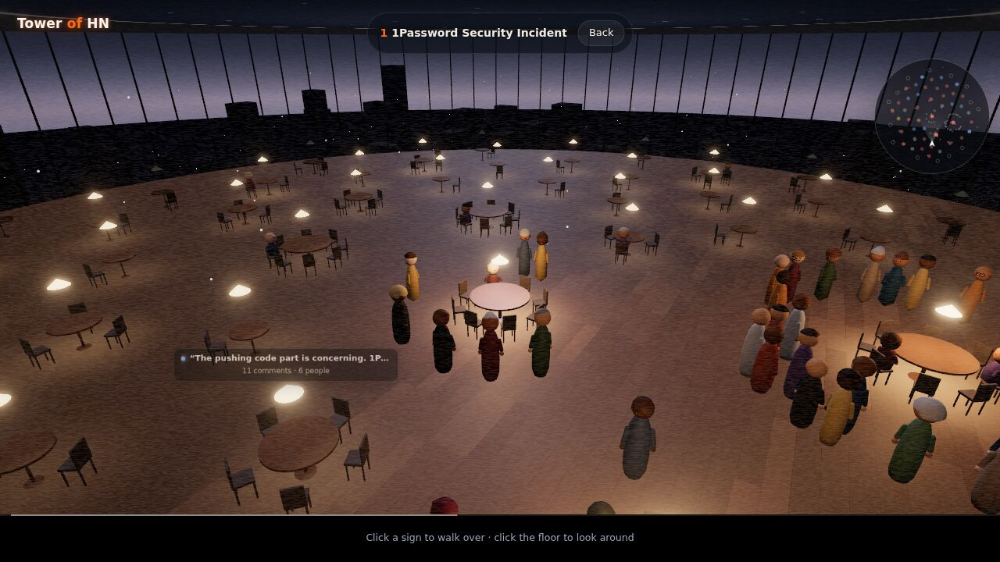
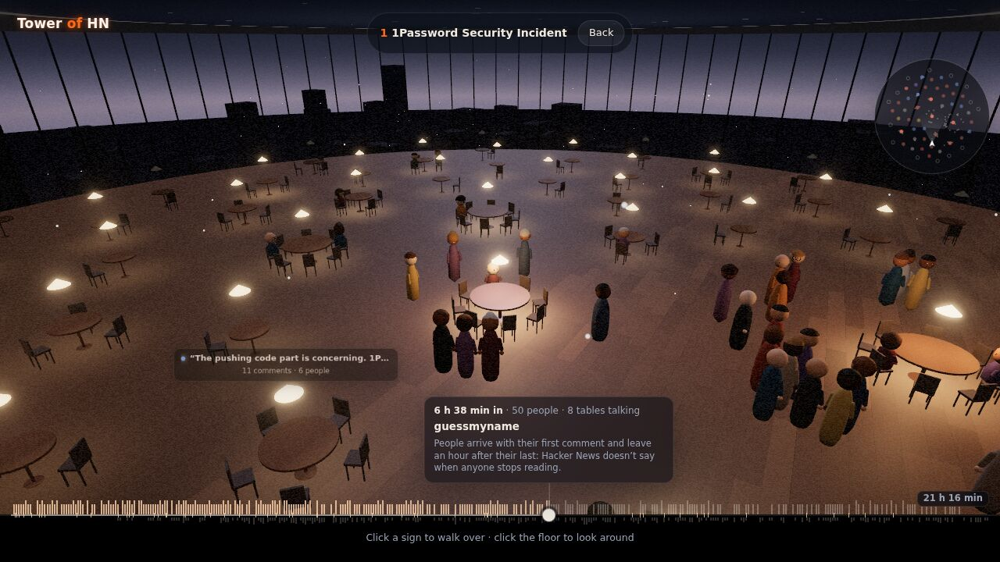
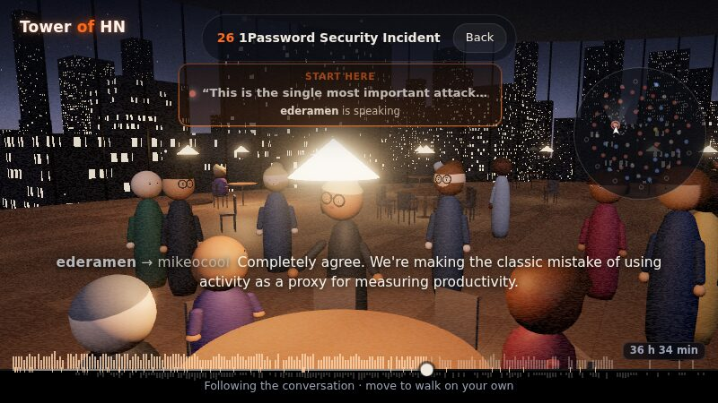

# Tower of HN

Hacker News as a living tower. Every floor is a front-page story, every table is a thread, and the people at it speak their comments, verbatim, in their own voices, as the conversation happens.

## See it

**Live at [towerofhn.taptappers.club](https://towerofhn.taptappers.club)**, with sound.

| The tower, HN's Y on its roof | A floor: one building, every table |
|---|---|
|  |  |
| **Drag the floor's line: the whole room at that moment** | **A table speaking, the camera following** |
|  |  |

These were rendered headlessly on a software GPU, so they look softer than on a real one.
[`docs/img/first-cut.mp4`](docs/img/first-cut.mp4) is the first cut (51 s with sound): that night's front page, a ride
up to floor #1, and a table talking in its own voices.

## Run it locally

You need:
- Node 24+
- Python 3.10–3.13, with `pip install -r apps/voice-worker/requirements.txt`
- a WebGPU browser (Chrome, Edge, or Safari 26+)

```sh
scripts/dev.sh                 # live HN + voice worker + the client
open http://127.0.0.1:5288
```

**Voices.** Kokoro, on CPUs. It's free, and every HN user gets a unique, permanent blend of two built-in voices.
- towerd plans what to voice (any table you sit at jumps the queue; the best tables on the top floors are pre-voiced) and voice runners on any node claim it, a comment at a time, sending each clip as it's made. See `docs/SCALING.md`.
- For character-actor delivery: `TTS_ENGINE=openai OPENAI_API_KEY=sk-... scripts/dev.sh`. That uses gpt-4o-mini-tts, with a persistent persona per person plus the comment's emotion. Spend is capped by `OPENAI_BUDGET_MIN` (default 300 minutes ≈ $4.50).
- Speech runs at 1.12× (`PACE`), with brisk turn-taking.
- Every comment is tagged for emotion, stance, intensity and cues (question, joke, sarcasm, insult, praise, uncertain, story…) by Claude Haiku, in towerd, a table at a time. It takes `ANTHROPIC_API_KEY`, or any Anthropic-compatible endpoint (`AUTH2API_URL`, key in `AUTH2API_KEY`); without one, runners judge from the words.
- Bumping `VOICE_VERSION` re-voices everything in the background. The old audio keeps playing until each replacement lands.

## Using it

- **Tower.** Drag to orbit, and hover a floor to see its story. Click to ride the elevator up.
  - Floors slide when stories trade ranks.
  - Windows flash when a comment lands, and run coral (breathing) on a floor where a row is on: its tick on the rail turns red and its focus card says heated.
  - Stop on a floor and someone inside is heard through the glass, muffled, before you go in.
  - The first few landings are named in a note ("cogman10 just commented on floor 7"), and so is each floor that turns heated, once. Tap a note to go there.
  - The beacon pulses for every new comment on the front page.
- **Floor.** A floor is one building: every table and everyone who commented on the story, in a hall as big as the floor needs. The 1Password thread's 58 tables and 356 people fill a hall 52 m across; a floor of five people is the tower's own room. You arrive on foot.
  - **The line along the bottom is the floor's own clock.**
    - Drag it, and the whole room goes to that moment. People walk in with their first comment and leave an hour after their last (HN never says when anyone stops reading). Tables open dark and light up as their comments land, and each table's sign counts what it had by then.
    - Let go, and the floor plays from there: every comment in the order it was written, wherever it was written. The camera travels to each table as its comment is said; a move of your own takes it back.
    - The lift chimes as people walk in.
    - Any path through the line lands on the same room as going there directly. `?t=` links a moment.
  - **Desktop:** click the floor and the mouse looks around (Esc gives it back); WASD or the arrows walk, Shift hurries. A dot in the middle aims: click someone to see their card, a table to walk over. E sits down.
  - **Phone:** the left thumb walks (a stick appears where it lands), the right thumb looks round; tap a table to go to it, someone to see their card.
  - **Signs** over the nearest tables say what each is about (its opener's first words) and how far it had got at the floor's moment.
  - **The map** (top right) shows the whole building: the tables lit as lively as they are, everyone in the room, the lift, and the table that's speaking. Tap a table to walk there.
  - Whoever speaks says it at their table: from their chair if they have one, otherwise stepping out of the crowd to its front. The crowd turns to look.
- **Table.** Space pauses, N moves to the next table, Esc stands you up, M mutes. The floor's line stays along the bottom, with your table's stretch lit; drag it to hear from any comment, or step with the arrows.
  - Words are said the way a person reads them aloud: "$1.2T" is "1.2 trillion dollars", "LLMs" is "L L Ms", and a link is where it goes ("a GitHub link", "a link to N Y Post dot com"). See `docs/SPEECH.md`.
  - Links are held up as placards you can click.
  - When someone quotes the comment they're answering, its author speaks the quote.
- **Reply, by voice** (behind the `reply` switch, off on the live site). On someone's card, while seated (Reply, or R), or aiming at them: speak, read your words back, fix them, and post. Your browser turns speech into text (nothing rewrites it), the room goes quiet while you talk, and your draft is kept (through closing, a reload, or a phone dropping the tab). Posting is a hand-off: your words are copied and HN's own reply page opens on that comment, so you paste and press reply there (signing in on HN if it asks; we never see a password); the sheet then finds your reply on HN and links to it. A companion extension (`apps/extension`, not published) would post straight from your browser with your own HN session. Your HN name is learned from your first reply (kept in your browser only), and replies to you are brought to your ears on the floor you're on, with a note for the ones elsewhere. See `docs/POSTING.md`; the tests (an HN mock and Playwright on three engines) are in `apps/client/e2e`.
- **Lean back:** top right on the tower. It rides to the liveliest floor, plays its best tables one after another, then moves down the ranking, hands-free.
- **Deep link:** `?story=<id>&table=<root comment id>`. The address bar updates as you sit down. Add `&from=<comment id>` to hear the opener, then jump straight to that reply, or `&t=3h12m` for a moment on the floor's clock.

## The acting

The tags drive the performance, and nothing is canned:
- **Turning to people.** Whoever replies turns to the person they're answering: shoulders part of the way, head the rest, eyes ahead of the head. Listeners watch the speaker, and everyone's eye-line tilts up to someone standing.
- **Standing up.** A heated reply (angry, or a strong disagreement) starts before the other person has finished. The speaker leans over the table, pushes off it (a thump on the wood, and the lens feels it), the chair scrapes back, and they stand and glare down at whoever they're answering. The room turns to look.
- **Gestures by tone.**
  - A pointed finger for pushback.
  - Open palms for questions.
  - A shrug, and looking up to find the words, when unsure.
  - Arms up when excited, a facepalm when frustrated, hand to chin when thinking.
  - An eye-roll on sarcasm.
  - A laugh at the end of a joke, which spreads round the table.
- **Listeners.**
  - The person being told off is taken aback.
  - The table gasps at an insult.
  - Whoever is praised lights up, hand to chest.
  - Someone about to disagree narrows their eyes and shakes their head.
- **Comebacks.** Someone hitting back at whoever challenged them (the tagger reads each reply against what it answers, and knows a reply back in a back-and-forth) leans in with narrowed eyes and a half smile, points, and comes in fast; if it really stings they stand. The one it's aimed at looks stung, the rest of the table goes "oooh".
- **Voices.** Heated and excited lines carry, sad and tender ones sit back (within ±2.5 dB).
- **Timing.** Heated replies cut in, a joke gets room for its laugh, and an answer to a question comes quickly.
- **The camera.** A small virtual cinematographer models everyone as capsules and won't shoot through a head. It keeps faces visible and changes angle and size on long comments. Its shots:
  - a rise shot, then a hero angle looking up at the one standing, over the shoulder of the one being told off
  - a reverse looking down at them
  - reaction cutaways to whoever is being answered
- **Long threads.** A table seats 8 and fits 8 more standing. Whoever is about to speak takes the place of someone who isn't due to.

## Layout

```
packages/core       speakability and spoken forms, play order, seats, permanent voices, live state (`node --test packages/core/src/*.test.ts`)
apps/towerd         local stand-in for the edge + CDN: follows live HN, writes head/epoch/floor files, queues voicing
apps/voice-worker   tags, voices (Kokoro or OpenAI), writes clips + sidecars with loudness and mouth-shape tracks
apps/client         the 3D client: three.js on WebGPU, plain TypeScript
apps/extension      the companion browser extension for replying (not published)
spikes/ research/   the first night's experiments and evidence
docs/PLAN.md        the plan; docs/img has the demos
```

## Vibe-testing the director

The client renders headlessly on a software GPU (`?record` makes time deterministic):
- `tools/sheet.cjs` grabs a frame every few seconds, with the camera's choice and the subtitle. `tools/tile.py` tiles them into one contact sheet.
- `tools/plan.py` draws top-down plans of a table: who sits where, who stands, where the lens is.
- `tools/record.cjs` and `tools/mux.py` make videos with the real voices and the synthesized chair scrapes and thumps.
- `?force=angry|joke|question|uncertain|excited|sad|list|sarcasm` makes every turn play that way.
- `?lite` starts without bloom and depth of field. It also switches itself on when frames stay slow at 1× resolution.
- For takes that live HN can't rewrite mid-shot:
  - `?freeze` ignores table updates while seated.
  - `?skip=<id>,<id>` leaves comments out.

## Production

It runs on the homelab (`homelab.setup/kubernetes/apps/towerofhn`), at https://towerofhn.taptappers.club, behind Cloudflare: a Cloudflare Tunnel reaches towerd on its own edge port, and the CDN answers the polls and the immutable files. Its Kubernetes objects and images keep the name it first went out under, `towerofhan`: a deploy never deletes, so renaming them would start a second copy beside the running one, and new image names would rebuild and re-pull every layer.
- `towerofhan` on the control plane: `towerofhan-web` (towerd, which also serves the built client) and a fallback voice lane, sharing `/data`
- `towerofhan-runner`, one per worker node: `towerofhan-voice` lanes that voice what towerd hands out on its in-cluster voice port

Both images are private, in GHCR. `docs/DEPLOY.md` covers the costs and the reasoning.

- **Switches.** How the room plays is switched in towerd's `CLIENT_FLAGS` and carried to every page in `head.json`. The live site runs `stream,cue,quick,crowd,timeline,floor,fast`; `reply` (replying to HN) is off. `docs/LAUNCH.md` has each one and how to roll it back; `?play=` tries a set on one page.
- **Support.** `SPONSOR_URL` (GitHub Sponsors) and `SPONSOR_COFFEE` (Buy Me a Coffee) put two small icons by the name, a line at the foot of the start page and a `/support` page. Unset, nothing of it is in the page.
- **Release.** Push an annotated tag `vX.Y.Z` on its own; CI builds and pushes both images at that version. Then bump the three image tags in homelab.setup's `values.yaml` (tag AND digest; the voice image is used twice), deploy that branch with `deploy-stuff.yml --ref`, check it, and merge.
- **Housekeeping is automatic.**
  - Deltas, old floor revisions and audio past `RETENTION_DAYS` are pruned. With `AUDIO_POLICY=tower`, audio is kept only while a floor can still play it, capped, and never written into a nearly full disk: `docs/AUDIO.md`.
  - Stories two days off the front page are forgotten.
  - A comment HN deletes or kills loses its audio.
- **Opt-out.** Add the HN username to `/data/optout.txt` (one per line; read every minute), or to `OPTOUT`. Their comments leave every table and their audio is deleted; replies to them still play.
- **Tagging.** Claude Haiku through the in-cluster auth2api by default; set `ANTHROPIC_API_KEY` to use the Anthropic API directly.
- **Health.** `/livez` is liveness. `/status` reports counts: items, voiced, queued, demand, and voicing (lanes, nodes, real-time factor). `GET :8788/voice/status` lists every lane.

## Status

Live since November 2026: the front page as it happens, every comment voiced on CPUs as it lands, each floor one
building you can scrub through time. `docs/PLAN.md` was the first night's plan; `docs/LAUNCH.md` is what launched,
what each switch does, and how to roll each part back.

## Support

Tower of HN is made by one person, Rounak Datta. If it gave you something, you can
[sponsor it on GitHub](https://github.com/sponsors/rounakdatta), monthly or once, or
[buy me a coffee](https://buymeacoffee.com/rounakdatta). It pays for the servers that read the comments aloud.
